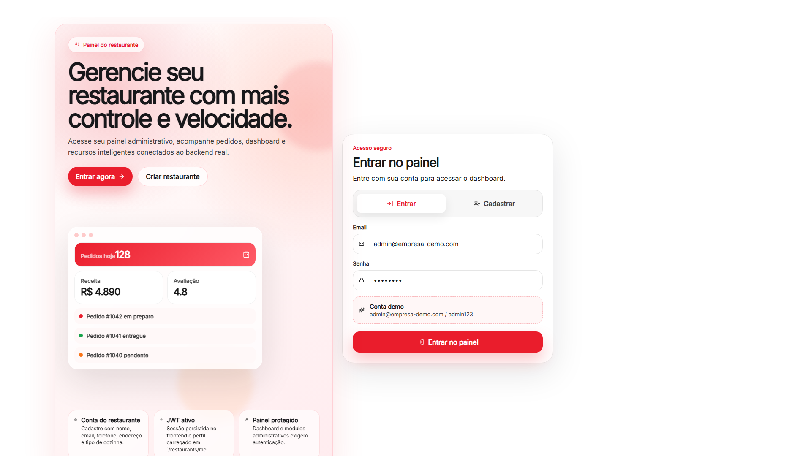
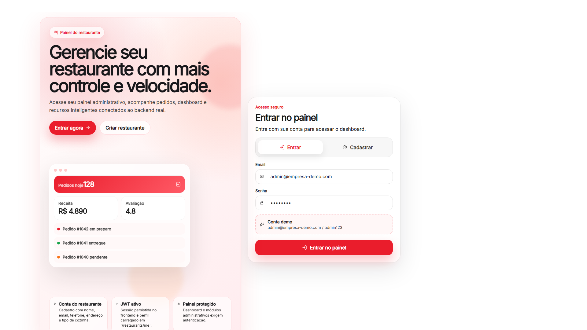
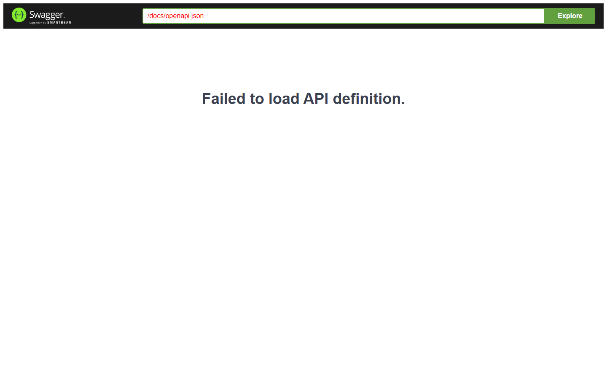

# 🍽️ iFood Copilot — Gestão Inteligente para Restaurantes

> **Solução Full-Stack desenvolvida durante o Hackathon iFood para otimização operacional, predição de entregas com Machine Learning e gestão integrada de cardápio e estoque.**

[](https://nuxt.com/)
[](https://vuejs.org/)
[](https://flask.palletsprojects.com/)
[](https://github.com/0b01001001/spectree)
[](https://www.sqlalchemy.org/)
[](https://pytorch.org/)
[](LICENSE)

---

## 📌 Visão Geral

O **iFood Copilot** é uma plataforma analítica e operacional concebida para auxiliar donos de restaurantes parceiros do iFood a tomar decisões em tempo real. O sistema integra um painel administrativo de alta performance em Nuxt 4 com uma API robusta em Flask, suportando persistência transacional com SQLAlchemy, autenticação JWT, documentação interativa OpenAPI/SpecTree e modelos de inteligência analítica em PyTorch para otimização de pedidos e entregas.

---

## 📸 Demonstração Visual da Aplicação

### Dashboard Analítico & Módulo Copilot
| Painel Geral (Nuxt 4) | Copilot & Insights IA |
|:---:|:---:|
|  |  |

### Gestão Operacional & Documentação OpenAPI
| Gestão de Pedidos | Estoque Inteligente |
|:---:|:---:|
|  |  |

| Cardápio Digital | Swagger OpenAPI (Flask) |
|:---:|:---:|
|  |  |

---

## ✨ Funcionalidades Principais

- 📊 **Dashboard Administrativo:** Monitoramento de faturamento em tempo real, pedidos ativos e métricas de desempenho.
- 🤖 **IA Copilot & Insights:** Assistente analítico integrado para sugestões de reposição, precificação e identificação de gargalos.
- 📦 **Controle de Estoque Inteligente:** Gestão de insumos com baixa automática por ficha técnica de receita dos pratos.
- 🛵 **Rastreio e Análise Logística:** Processamento de dados históricos (`deliveries_train.csv` / `deliveries_test.csv`) com modelo em PyTorch.
- 📋 **Cardápio Digital (CRUD Completo):** Cadastro, precificação, disponibilidade e categorização dinâmica.
- 📖 **Documentação Swagger/Redoc:** Endpoints 100% tipados e documentados via SpecTree em `/docs/swagger/` e `/docs/redoc/`.

---

## 🛠️ Tecnologias Utilizadas

### Frontend
- **Framework:** [Nuxt 4](https://nuxt.com/) (Vue 3.5 com Composition API & TypeScript)
- **Módulos:** `@nuxt/icon`, `@nuxt/fonts`, `@nuxt/a11y`, `@nuxt/eslint`
- **Porta Padrão:** `http://localhost:3001`

### Backend
- **Microframework:** [Flask 3.1](https://flask.palletsprojects.com/)
- **Documentação de API:** [SpecTree](https://github.com/0b01001001/spectree) (OpenAPI / Swagger / Redoc)
- **ORM & Migrations:** [SQLAlchemy 2.0](https://www.sqlalchemy.org/) & [Alembic](https://alembic.sqlalchemy.org/)
- **Autenticação:** `Flask-JWT-Extended` & `flask-cors`
- **Machine Learning:** [PyTorch 2.13](https://pytorch.org/) & Pydantic 2.11
- **Porta Padrão:** `http://localhost:5001`

---

## 📁 Estrutura de Pastas

```bash
IfoodCopilot_hackathonIfood/
├── assets/
│   └── screenshots/                 # Capturas de tela da aplicação em execução
│       ├── preview.png              # Dashboard inicial
│       ├── copilot.png              # Insights com IA
│       ├── orders.png               # Gestão de pedidos
│       ├── inventory.png            # Estoque
│       ├── menu.png                 # Cardápio
│       ├── finance.png              # Financeiro
│       └── swagger.png              # Documentação OpenAPI
├── backend/
│   ├── config.py                    # Configuração de CORS, JWT e banco
│   ├── factory.py                   # Padrão Application Factory Flask
│   ├── main.py                      # Ponto de entrada do backend (porta 5001)
│   ├── requirements.txt             # Dependências Python travadas
│   ├── populate_database.py         # Script para carga inicial do banco
│   ├── controllers/                 # Controladores REST desacoplados
│   │   ├── auth_controller.py
│   │   ├── dashboard_controller.py
│   │   ├── inventory_controller.py
│   │   ├── menu_controller.py
│   │   ├── order_controller.py
│   │   └── restaurant_controller.py
│   ├── datasets/                    # Datasets de logística do hackathon
│   │   ├── deliveries_train.csv
│   │   └── deliveries_test.csv
│   └── models/                      # Entidades ORM (Restaurante, Pedido, Estoque)
├── front/
│   ├── app/                         # Páginas e componentes Nuxt 4
│   │   └── app.vue                  # Componente raiz
│   └── package.json                 # Dependências Node.js
└── README.md
```

---

## ⚙️ Pré-requisitos

- **Node.js** v20.x ou superior
- **Python** 3.11 ou 3.12
- **Git**

---

## 🚀 Como Executar Localmente

### 1. Backend (Flask + SpecTree)
```bash
cd backend

# Criar e ativar ambiente virtual
python -m venv venv
# Windows:
venv\Scripts\activate
# Linux/Mac:
source venv/bin/activate

# Instalar dependências
pip install -r requirements.txt

# Popular o banco de dados
python populate_database.py

# Iniciar servidor na porta 5001
python main.py
```
Acesse a documentação Swagger em: `http://localhost:5001/docs/swagger/`

### 2. Frontend (Nuxt 4)
Em outro terminal:
```bash
cd front

# Instalar dependências
npm install

# Iniciar na porta 3001
PORT=3001 npm run dev
```
Acesse o painel em: `http://localhost:3001`

---

## 🧠 Decisões Técnicas e Arquiteturais

1. **Separação Rígida Client-Server:** O frontend Nuxt 4 desacoplado consome dados via API RESTful tipada, viabilizando escalabilidade e deploys independentes.
2. **SpecTree OpenAPI Contract:** Garantia de tipagem estrita com Pydantic e geração automática de documentação Swagger/Redoc.
3. **Application Factory Pattern:** Inicialização limpa e testável de extensões e blueprints no Flask.

---

## 📄 Licença

Distribuído sob a licença MIT. Consulte `LICENSE` para mais informações.
